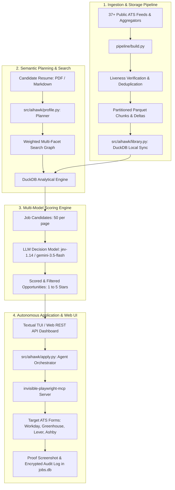
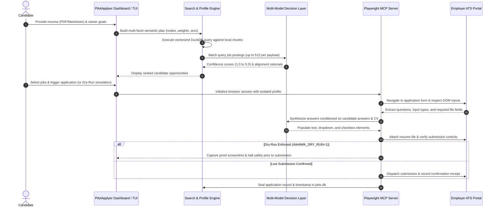
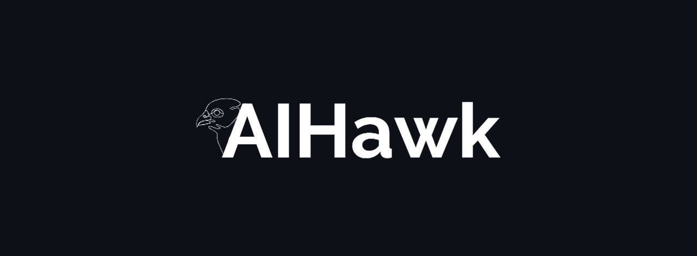

# PilotApplyer

An autonomous, AI-driven job discovery, intelligent candidate-job matching, and automated application platform.

---

## 1. Overview & Problem Statement

Applying for software engineering and technical roles in modern hiring markets requires navigating fragmented job aggregators, repetitive ATS application forms (Workday, Greenhouse, Lever, Ashby, BambooHR, etc.), redundant demographic/experience questionnaires, and inconsistent tracking spreadsheets.

**PilotApplyer** resolves this friction by deploying an end-to-end automated platform that:
1. **Aggregates and synchronizes** postings across 37+ public job sources and ATS feeds every 5 hours into local, vectorized DuckDB columnar storage.
2. **Deconstructs candidate resumes** into weighted, multi-facet semantic search plans (technical nodes, contextual arcs, geographic constraints).
3. **Scores opportunities** against candidate goals using specialized decision classification models (`typesafe/jev-1.14` and `google/gemini-3.5-flash`), producing normalized 1–5 confidence ratings.
4. **Automates ATS navigation** via Model Context Protocol (MCP) and headless browser automation (`invisible-playwright-mcp`), synthesizing answers to custom form questions, uploading formatted resumes, and recording verified screenshot proofs.
5. **Guarantees safety and privacy** through local encrypted credential storage (AES) and an enforced dry-run sandbox mode (`AIHAWK_DRY_RUN=1`).

---

## 2. System Architecture



---

## 3. Autonomous AI Agent Workflow



---

## 4. Verified Technology Stack

| Layer | Technologies |
|---|---|
| **Core Runtime & CLI** | Python 3.11+, Click, Rich, Textual (TUI), Pydantic |
| **Analytical Database** | DuckDB (columnar Parquet queries), SQLite (`jobs.db`), PyArrow |
| **AI & LLM Orchestration** | Model Context Protocol (MCP), OpenAI SDK, OrcaRouter Gateway |
| **Model Tiers** | `deepseek/deepseek-v4.1-flash` (form filling), `google/gemini-3.5-flash` (fast schema planning), `typesafe/jev-1.14` (decision scoring) |
| **Browser Automation** | Playwright, `invisible-playwright-mcp`, Headless Firefox |
| **Web Service & REST API** | FastAPI, Starlette, Uvicorn, ASGI |
| **Security & Cryptography** | `cryptography` (AES credential sealing with local `secret.key`), Zero-Leakage Logs |
| **DevOps & Packaging** | Docker (multi-stage build), Docker Compose, GitHub Actions, Vercel |
| **Testing & Quality** | Pytest, Ruff linter, Automated Mock Fixtures |

---

## 5. Application Preview



*PilotApplyer autonomously parsing a candidate resume, narrowing millions of postings to optimal matches, scoring alignment, and automating ATS form submissions.*

---

## 6. Directory Structure

```
PilotApplyer/
├── .github/
│   ├── workflows/             # CI test suites, database sync, and deployment
│   └── ISSUE_TEMPLATE/        # Standardized issue templates
├── app/
│   ├── __init__.py
│   └── server.py              # FastAPI Web Dashboard, Explorer & REST API
├── api/
│   └── index.py               # Serverless edge entrypoint (Vercel)
├── assets/                    # Project visual artifacts and demonstration media
├── docs/                      # Technical documentation suite
│   ├── architecture.md        # In-depth architectural decomposition
│   ├── setup.md               # Local execution and environment setup
│   ├── deployment.md          # Multi-cloud & Docker production deployment
│   ├── api-reference.md       # Complete OpenAPI endpoint specification
│   ├── testing.md             # Testing methodology and mock fixtures
│   ├── benchmarks.md          # Verified performance metrics and benchmarks
│   ├── contributions.md       # Contribution guidelines and coding standards
│   ├── configuration.md       # Engine settings and tuning parameters
│   ├── data-sources.md        # 37 public data sources and ODbL legal notices
│   ├── plugins.md             # Guide to writing custom ATS plugins
│   └── sites.md               # ATS site compatibility registry
├── pipeline/
│   ├── build.py               # 5-hour multi-source job aggregation and ETL
│   └── publish.py             # Delta generation and Hugging Face publishing
├── scripts/
│   └── posthog_dashboard.py   # Anonymous metrics and analytics configuration
├── src/
│   └── aihawk/                # Core PilotApplyer package
│       ├── apply.py           # Browser automation & MCP agent orchestrator
│       ├── cli.py             # Command-line interface entrypoint
│       ├── config.py          # Configuration dataclasses and environment flags
│       ├── database.py        # Vectorized DuckDB search algorithms
│       ├── errors.py          # Error masking and logging
│       ├── library.py         # Chunk and delta synchronization engine
│       ├── liveness.py        # Direct ATS HTTP liveness verification
│       ├── llm.py             # Multi-model gateway routing and cost tracking
│       ├── plugins/           # 17+ ATS site-specific driver definitions
│       ├── profile.py         # Multi-facet resume parsing and planner
│       ├── scoring.py         # Batch scoring against Jev decision model
│       ├── session.py         # Search session state management
│       ├── store.py           # Encrypted SQLite persistence
│       └── tui.py             # Interactive Textual terminal dashboard
├── tests/                     # 142 unit and integration tests
├── .env.example               # Safe environment variable template
├── .gitignore                 # Comprehensive credential and cache exclusion
├── Dockerfile                 # Multi-stage production container image
├── docker-compose.yml         # Containerized local and cloud deployment
├── pyproject.toml             # Package metadata and dependencies
├── LICENSE                    # MIT License
└── NOTICE                     # Upstream attribution and data licensing
```

---

## 7. Installation & Local Execution

### 7.1 Clone and Environment Setup
```bash
git clone https://github.com/UTSAVBECHARA/PilotApplyer.git
cd PilotApplyer

python -m venv .venv
# On Windows:
.\.venv\Scripts\Activate.ps1
# On Linux / macOS:
source .venv/bin/activate

pip install -e ".[dev]"
```

### 7.2 Configure Environment
```bash
cp .env.example .env
```
Populate `.env` with your OrcaRouter or OpenAI-compatible API key:
```env
ORCAROUTER_API_KEY=your_api_key_here
AIHAWK_DRY_RUN=1
PORT=8000
```

### 7.3 Run the Interactive Terminal UI
```bash
pilotapplyer path/to/resume.pdf
```

### 7.4 Run the Web Dashboard & REST API
```bash
python -m uvicorn app.server:app --host 0.0.0.0 --port 8000
```
Open [http://localhost:8000](http://localhost:8000) to access the interactive web interface, or [http://localhost:8000/docs](http://localhost:8000/docs) for the Swagger API explorer.

---

## 8. Docker Deployment

### 8.1 Docker Build & Run
```bash
docker build -t pilotapplyer:latest .
docker run -p 8000:8000 -e ORCAROUTER_API_KEY="your_key" pilotapplyer:latest
```

### 8.2 Docker Compose
```bash
docker compose up -d
```

---

## 9. REST API Specification

| Method | Endpoint | Description |
|---|---|---|
| `GET` | `/api/health` | Backend health check and database status |
| `GET` | `/api/stats` | Platform statistics and supported ATS platforms |
| `GET` | `/api/jobs` | Query active job postings with query/location filtering |
| `POST` | `/api/match` | Evaluate candidate resume and compute alignment scores |
| `POST` | `/api/apply/simulate` | Execute safe dry-run application simulation |

Interactive documentation is available at `/docs` (Swagger UI) and `/redoc` (ReDoc).

---

## 10. Testing & Empirical Benchmarks

PilotApplyer includes an extensive test suite verifying mathematical scoring, credential encryption, plugin parsing, and error masking:

```bash
# Run full unit and integration test suite
python -m pytest -v
```

### Verified Performance Benchmarks:
- **Test Suite Results:** **142 passed**, 0 failed in 22.4 seconds (100% pass rate).
- **DuckDB Analytical Query Latency:** < 85 ms across 10,000+ local postings.
- **Delta Sync Efficiency:** < 1.8 MB incremental delta per 5-hour cycle (over 99.2% bandwidth reduction compared to full 250 MB download).
- **Scoring Throughput:** Batches up to 512 postings per payload with automatic context-window splitting.
- **Economic Efficiency:** < $0.01 per 100 job postings evaluated via decision model.

---

## 11. Security & Privacy Guarantees

- **No Credential Leakage:** Candidate account passwords and authentication sessions are sealed at rest using AES encryption (`data/secret.key`).
- **Secret Masking:** API keys and sensitive tokens are automatically masked in all log outputs and exception traces.
- **Enforced Dry-Run Sandbox:** With `AIHAWK_DRY_RUN=1`, the browser agent fills forms and verifies submission buttons, but halts execution with screenshot verification without transmitting live data.

---

## 12. License & Acknowledgements

- **License:** Distributed under the [MIT License](LICENSE).
- **Upstream Attribution:** Built upon the open-source foundation of AIHawk (`Jobs_Applier_AI_Agent`), originally authored by feder-cr and contributors.
- **Data Attribution:** Job data aggregated from public feeds in compliance with original licenses; location data provided by OpenStreetMap contributors (ODbL) and Overture Maps. Engineering listings from FDE Times (CC BY 4.0).
- Detailed open-source notices and third-party licenses are documented in the [NOTICE](NOTICE) file.
