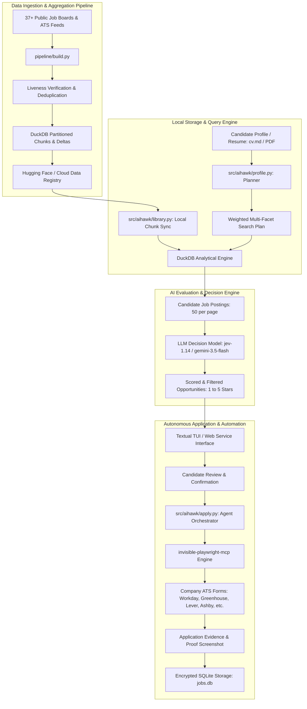

# Pursuit System Architecture

## 1. Architectural Overview

Pursuit is an autonomous, AI-driven job discovery, multi-facet candidate matching, and automated application system. The platform bridges large-scale job market ingestion with local edge intelligence and headless browser automation.

---

## 2. Component Subsystems

### 2.1 Ingestion & Pipeline Subsystem (`pipeline/`)
- **Automated Scraping & Aggregation (`pipeline/build.py`)**: Gathers postings across 37 major job aggregators, company ATS feeds (Greenhouse, Lever, Workday, Ashby, BambooHR, SmartRecruiters, etc.), and specialized portals every 5 hours.
- **Deduplication & Canonicalization**: Postings are keyed by canonical URL, employer domain, and posted timestamp.
- **Delta Generation (`pipeline/publish.py`)**: Computes incremental differences (`add` and `drop` operations) against previous builds, drastically minimizing client bandwidth requirements (sub-megabyte deltas).

### 2.2 Storage & Query Engine (`src/aihawk/library.py`, `database.py`)
- **DuckDB Embedded Analytics**: Employs DuckDB for vectorized SQL queries across columnar Parquet chunks without loading entire datasets into memory.
- **Two-Tier Synchronization**: Downloads lightweight chronological deltas first, updating local indices before querying historical chunks on-demand.
- **Relational Persistence (`jobs.db`)**: Tracks application history, candidate answers, company account credentials, and review status locally with zero cloud leakage.

### 2.3 Semantic Planner & LLM Decision Layer (`src/aihawk/profile.py`, `scoring.py`, `llm.py`)
- **Semantic Plan Generation**: Deconstructs candidate resumes into hierarchical multi-facet search graphs comprising:
  - **Nodes**: Weighted technical proficiencies, seniority levels, and primary job titles.
  - **Arcs**: Contextual scaling modifiers that conditionally amplify or suppress relevancy scores based on explicit keywords.
  - **Location Filters**: Strict geographic boundary definitions supporting remote, hybrid, and on-site preferences.
- **Tiered Multi-Model Architecture**:
  - *Fast Planning & Parsing*: Lightweight models (`google/gemini-3.5-flash`) for low-latency schema extraction.
  - *Relevancy Scoring*: Specialized classification models (`typesafe/jev-1.14`) generating 1–5 confidence ratings.
  - *Dynamic Form Automation*: High-reasoning vision and instruction models (`deepseek/deepseek-v4.1-flash`) for form filling and screenshot analysis.

### 2.4 Browser Automation & MCP Agent (`src/aihawk/apply.py`)
- **Model Context Protocol (MCP)**: Utilizes `invisible-playwright-mcp` to communicate via standard JSON-RPC over stdio, decoupling the browser execution environment from the AI orchestrator.
- **Plugin Architecture (`src/aihawk/plugins/`)**: Tailored site-specific drivers for 17+ ATS platforms (Workday, Greenhouse, Lever, Ashby, BambooHR, iCIMS, Paylocity, Personio, Recruitee, SmartRecruiters, Teamtailor, Workable, etc.).
- **Dry-Run Simulation**: Supports safe end-to-end trials (`AIHAWK_DRY_RUN=1`) where candidate forms are fully inspected and filled, but final submission actions are blocked and recorded with screenshot proof.

### 2.5 Security & Credential Isolation (`src/aihawk/secret.py`)
- **At-Rest Encryption**: Candidate account passwords and authentication sessions are sealed using symmetric AES encryption with keys stored locally in `data/secret.key`.
- **Zero Inadvertent Credential Exposure**: API keys, browser sessions, and personal resumes are isolated from git tracking and cloud logs.
